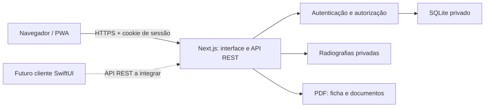

# Arquitetura

## Componentes

O EndoDelivery utiliza Next.js 16 com App Router, React 19, TypeScript e Tailwind CSS 4. O ambiente é Node.js 24: o SQLite nativo de `node:sqlite` evita um serviço adicional de banco na primeira etapa. Os registros são persistidos em arquivo e as radiografias ficam em armazenamento privado no mesmo host.

O service worker guarda somente ícones públicos e uma página offline. Dados clínicos não têm suporte offline nesta etapa.

## Camadas

- `app/(auth)` contém cadastro e entrada.
- `app/(clinic)` contém pacientes, agenda, documentos e perfil.
- `app/api` expõe endpoints REST em JSON, multipart e PDF. A API usa `snake_case` e não depende dos componentes React.
- `lib/auth.ts` deriva senhas com scrypt, gerencia sessões opacas e verifica a conta autenticada.
- `lib/db.ts` aplica migrações versionadas e mantém uma conexão SQLite por processo.
- `lib/storage.ts` valida e normaliza imagens com Sharp, remove metadados e impede caminhos arbitrários.
- `lib/pdf.ts` produz PDFs a partir de registros já autorizados, usando pdf-lib.

Rotas com acesso a dados exigem uma sessão válida e filtram as consultas por `user_id`. Associações também são verificadas: um atendimento, agendamento ou documento não pode referenciar um paciente de outra conta. Chaves estrangeiras compostas reforçam esse vínculo no banco.

## Modelo de dados

| Tabela | Responsabilidade |
| --- | --- |
| `users` | Conta, e-mail e derivação da senha |
| `sessions` | Hash do token e expiração da sessão |
| `profiles` | Identidade profissional, contato e logotipo |
| `patients` | Identificação, encaminhamento e observações |
| `visits` | Atendimento, elemento e ficha clínica; canais em JSON validado |
| `radiographs` | Referências privadas a imagens, paciente, atendimento opcional e legenda |
| `appointments` | Data, horário, clínica, procedimento e status |
| `templates` | Modelos editáveis de receituário e recomendações |
| `documents` | Conteúdo emitido e salvo, independente das edições futuras do modelo |
| `schema_migrations` | Versões de migração aplicadas |

Os IDs são UUIDs aleatórios. Datas de atendimento e agenda usam `YYYY-MM-DD`, e horários usam `HH:mm`; esses valores representam a agenda local informada pelo profissional. Instantes de criação e expiração são registrados em UTC. O preenchimento automático de `{{data}}` usa a data local de Manaus nesta etapa.

## Persistência e exclusões

O SQLite usa WAL, chaves estrangeiras e tempo de espera para bloqueios. Migrações são idempotentes: reiniciar o processo não recria os dados. O banco padrão fica em `data/endodelivery.sqlite`; arquivos adicionais `-wal` e `-shm` fazem parte do funcionamento normal do SQLite e não devem ser manipulados isoladamente.

Excluir um paciente remove os atendimentos, agendamentos, documentos e radiografias vinculados. Excluir um atendimento remove as radiografias associadas a ele. O processo limpa os arquivos privados antes de concluir a exclusão dos metadados; se a remoção de um arquivo falhar, os metadados permanecem para permitir nova tentativa. A remoção física não é transacional: se uma operação falhar após alguns arquivos já terem sido removidos, esses arquivos não serão recuperados automaticamente.

Excluir um modelo desassocia os documentos emitidos, preservando seus textos. PDFs são gerados sob demanda e não ficam em uma pasta pública.

## Operação

Esta configuração usa um processo de aplicação com volume persistente. Processos, sessões HTTP ativas e portas abertas não substituem os comandos de inicialização. O caminho `/api/health` consulta o banco para verificar a disponibilidade básica; ele não substitui um teste de fluxo clínico.

Em produção, configure `APP_ORIGIN` com a origem HTTPS exata e use um proxy confiável que sobrescreva os cabeçalhos de IP recebidos do cliente. O limitador de tentativas de autenticação é local ao processo e depende desses cabeçalhos; uma implantação distribuída precisará de um limitador compartilhado. Não coloque várias réplicas de escrita em hosts distintos usando cópias independentes do banco.

Antes de escalar, avalie PostgreSQL, armazenamento privado de objetos, migrações de dados e acesso autorizado a anexos. Um cliente SwiftUI poderá utilizar o contrato REST, mas ainda será necessário implementar o cliente, definir a experiência de autenticação nativa e testar seu tratamento de arquivos e sessões.

## Validação

`npm run check` combina lint, TypeScript e testes dos módulos. `npm run build` verifica a compilação de produção. O Playwright exercita a API e os fluxos de navegador com dados fictícios. Os requisitos operacionais e de proteção para informações reais estão em [Privacidade](privacy.md).
