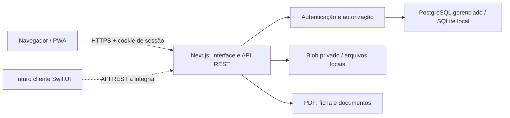

# Arquitetura

## Componentes

O EndoDelivery utiliza Next.js 16 com App Router, React 19, TypeScript e Tailwind CSS 4, em Node.js 24. Na Vercel, os registros usam PostgreSQL gerenciado e as radiografias usam Vercel Blob privado. O desenvolvimento local pode continuar com SQLite nativo e arquivos privados persistentes no mesmo host.

O service worker guarda somente ícones públicos e uma página offline. Dados clínicos não têm suporte offline nesta etapa.

## Camadas

- `app/(auth)` contém cadastro e entrada.
- `app/(clinic)` contém pacientes, agenda, documentos e perfil.
- `app/api` expõe endpoints REST em JSON, multipart e PDF. A API usa `snake_case` e não depende dos componentes React.
- `lib/auth.ts` deriva senhas com scrypt, gerencia sessões opacas e verifica a conta autenticada.
- `lib/db.ts` seleciona o adaptador; `lib/database/` contém o contrato assíncrono, migrações e implementações SQLite/PostgreSQL.
- `lib/storage.ts` valida e normaliza imagens com Sharp, remove metadados e impede caminhos arbitrários.
- `lib/pdf.ts` produz PDFs a partir de registros já autorizados, usando pdf-lib.

Rotas com acesso a dados exigem uma sessão válida e filtram as consultas por `user_id`. Associações também são verificadas: um atendimento, agendamento ou documento não pode referenciar um paciente de outra conta. Chaves estrangeiras compostas reforçam esse vínculo no banco.

## Modelo de dados

| Tabela | Responsabilidade |
| --- | --- |
| `users` | Conta, e-mail e derivação da senha |
| `sessions` | Hash do token e expiração da sessão |
| `auth_attempts` | Contadores de autenticação compartilhados, com identificadores derivados por hash e expiração |
| `profiles` | Identidade profissional, contato e logotipo |
| `patients` | Identificação, encaminhamento e observações |
| `visits` | Atendimento, elemento e ficha clínica; canais em JSON validado |
| `radiographs` | Referências privadas a imagens, paciente, atendimento opcional e legenda |
| `appointments` | Data, horário, clínica, procedimento e status |
| `templates` | Modelos editáveis de receituário e recomendações |
| `documents` | Conteúdo emitido e salvo, independente das edições futuras do modelo |
| `schema_migrations` | Versões de migração aplicadas |

Os IDs são UUIDs aleatórios. Datas de atendimento e agenda usam `YYYY-MM-DD`, e horários usam `HH:mm`; esses valores representam a agenda local informada pelo profissional. Instantes de criação e expiração são registrados em UTC. O preenchimento automático de `{{data}}` usa a data local de Manaus nesta etapa.

## Persistência e exclusões

O SQLite usa WAL, chaves estrangeiras e tempo de espera para bloqueios. Migrações são idempotentes: reiniciar o processo não recria os dados. O banco padrão fica em `data/endodelivery.sqlite`; arquivos adicionais `-wal` e `-shm` fazem parte do funcionamento normal do SQLite e não devem ser manipulados isoladamente.

O PostgreSQL usa um pool limitado e transações com cliente reservado. Um advisory lock coordena migrações em inicializações simultâneas de funções. O SQLite serializa operações assíncronas com mutex e usa o mesmo cliente durante uma transação. URLs remotas exigem TLS com verificação de certificado e hostname. A migração 2 adiciona limites de autenticação sem recriar as tabelas clínicas da versão 1.

Na Vercel, a falta de URL PostgreSQL ou de configuração de Blob produz erro de configuração; o aplicativo não redireciona registros clínicos para `/tmp`. Imagens são enviadas com acesso privado e o banco guarda apenas uma referência lógica ao objeto. A leitura exige autenticação e autorização da conta no endpoint da aplicação. O SDK autentica no servidor com a identidade OIDC automática do projeto conectado (`BLOB_STORE_ID`), mantendo a renovação da plataforma; conexões com `BLOB_READ_WRITE_TOKEN` continuam suportadas. O aplicativo não captura nem repassa o token OIDC às chamadas. Trocar o backend exige planejar separadamente a migração de dados e anexos já existentes.

Excluir um paciente remove os atendimentos, agendamentos, documentos e radiografias vinculados. Excluir um atendimento remove as radiografias associadas a ele. O processo limpa os arquivos privados antes de concluir a exclusão dos metadados; se a remoção de um arquivo falhar, os metadados permanecem para permitir nova tentativa. A remoção física não é transacional: se uma operação falhar após alguns arquivos já terem sido removidos, esses arquivos não serão recuperados automaticamente.

Excluir um modelo desassocia os documentos emitidos, preservando seus textos. PDFs são gerados sob demanda e não ficam em uma pasta pública.

## Operação

Fora da Vercel, SQLite e arquivos exigem um processo com volume persistente. Na Vercel, cada função pode reiniciar e depende dos serviços externos. Processos, sessões HTTP ativas e portas abertas não substituem os comandos de inicialização. O caminho `/api/health` consulta o banco e as migrações para verificar sua disponibilidade; ele não comprova acesso ao Blob nem substitui um teste de fluxo clínico.

Em produção, configure `APP_ORIGIN` com a origem HTTPS exata e use um proxy confiável que sobrescreva os cabeçalhos de IP recebidos do cliente. O limitador de autenticação usa contadores atômicos no banco por IP e, no login, também por e-mail derivado por hash; as instâncias compartilham os limites. Não coloque várias réplicas de escrita em hosts distintos usando cópias independentes de SQLite.

Os passos de configuração e verificação da implantação estão em [Vercel](vercel.md). Um cliente SwiftUI poderá utilizar o contrato REST, mas ainda será necessário implementar o cliente, definir a experiência de autenticação nativa e testar seu tratamento de arquivos e sessões.

## Validação

`npm run check` combina lint, TypeScript e testes dos módulos. `npm run build` verifica a compilação de produção. O Playwright exercita a API e os fluxos de navegador com dados fictícios. Os requisitos operacionais e de proteção para informações reais estão em [Privacidade](privacy.md).
